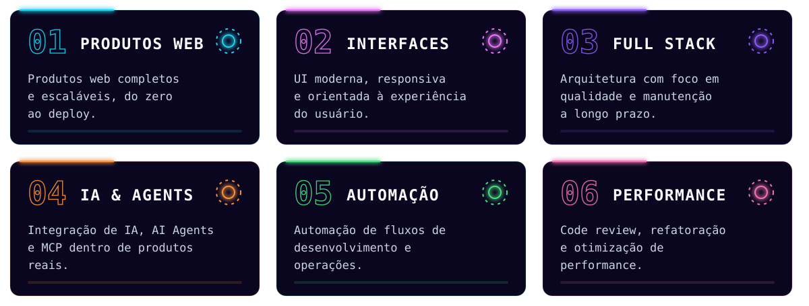

 

 

Sou **Software Engineer** com mais de **3,5 anos de experiência** construindo aplicações web robustas, interfaces de alta performance e soluções inteligentes para produtos digitais.

Atualmente atuo como **IA Engineer — Full Stack**, combinando engenharia de software com Inteligência Artificial ao longo de todo o ciclo de desenvolvimento: do planejamento e análise de requisitos à implementação, testes, refatoração e otimização.

> **`>_`** Transformo problemas complexos em experiências digitais simples, escaláveis e prontas para produção.

 

 

 

 

Disponível para novos projetos, consultoria técnica, desenvolvimento de software e soluções com Inteligência Artificial.

<!-- Os gráficos 3D e a cobrinha são gerados pelo workflow .github/workflows/profile-3d.yml -->
